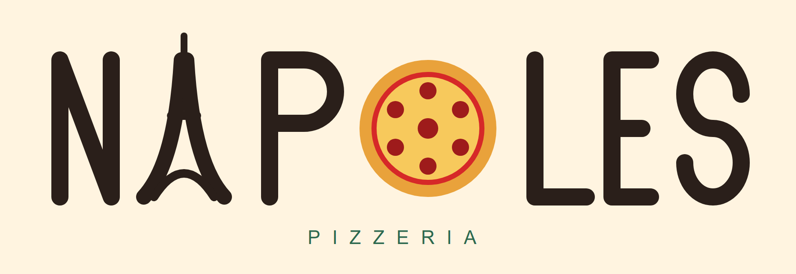

<p align="center">
  
</p>

# Nápoles 🍕

**Cross-platform ordering app for a local pizzeria.**
Intermodular Project · DAM (Multiplatform Application Development) – 2nd year · Victoria Institute of Technology – Sanlúcar de Barrameda · Academic year 2026/2027

---

## About the project

Small neighbourhood pizzerias still take orders by phone, WhatsApp and paper tickets, or depend on delivery platforms that charge a commission on every order and keep the customer data. **Nápoles** gives the business its own ordering channel, with no intermediaries and low maintenance cost.

The system has two parts sharing the same database:

| Part | Platforms | Main features |
|------|-----------|---------------|
| **Customer app** | Android, iOS, Web | Browse the menu, customise pizzas, order for pick-up or delivery, card payment, real-time order tracking |
| **Staff panel** | Tablet (kitchen) / Desktop (counter) | Live incoming orders, status updates (received → in the oven → ready → out for delivery → delivered), menu, prices and out-of-stock management |

## Repository structure

```
PI_DAM2_Napoles/
├── assets/   # Logo and graphic resources
├── docs/     # Project documentation (Practice 3: Introduction, Methodology)
└── src/      # Source code (in progress)
```

## Methodology

Agile approach based on **Scrum + Kanban**: short sprints, a prioritised product backlog and a Kanban board to track tasks. See [`docs/PI_DAM2_Napoles_Metodologia.docx`](docs/PI_DAM2_Napoles_Metodologia.docx).

## Status

🚧 **In progress** – analysis and documentation phase. Development of the apps will be added to `src/` in upcoming sprints.

## Team

| Member | GitHub |
|--------|--------|
| Román Gutiérrez Jurado | [@romijurado44](https://github.com/romijurado44) |

## License

Academic project – all rights reserved.
